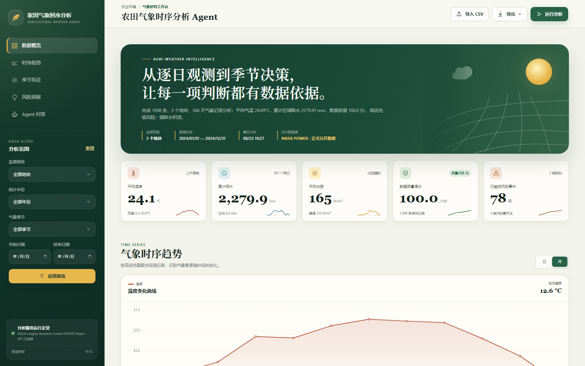

# 农田气象时序分析 Agent

Python / FastAPI / SQLite / FastMCP / Ollama ｜ 工程版本 **v1.2.0**

一个可离线运行的农田气象时序分析平台。系统把正式公开数据获取、来源追溯、CSV 导入、质量校验、SQLite 持久化、季节统计、趋势与异常识别、农业气象风险、本地模型 Agent、导出和审计串成同一条可复核闭环。首次启动会自动建库并导入 NASA POWER 2024 年深圳光明、龙岗、大鹏三个网格共 1,098 条日数据；标准启动脚本和未设置 Agent 环境变量的直接启动都默认使用 Ollama `qwen2.5:3b`，读取与问题相关的结构化分析上下文后自主生成回答，而不是套用固定正文。统计数值和证据目录仍由后端掌握；模型调用或输出校验失败时才返回确定性规则答案。隔离测试会显式注入 rules/mock runtime，不访问真实 Ollama。

[在线项目演示](https://yebeijianaili.github.io/agri-weather-agent/) · [功能演示视频](demo/agri-weather-agent-demo.mp4) · [API 契约](docs/API.md) · [架构文档](docs/ARCHITECTURE.md)



## 1. 直接运行

### 1.1 准备本地小模型（推荐）

Windows 首次安装 Ollama：

```powershell
winget install --id Ollama.Ollama -e --accept-package-agreements --accept-source-agreements
```

安装后新开 PowerShell。Ollama 桌面程序通常会自动启动本地 API；若 `11434` 尚未监听，可隐藏启动服务，然后拉取本项目默认模型：

```powershell
$ollamaExe = (Get-Command ollama -ErrorAction Stop).Source
try {
  Invoke-RestMethod "http://127.0.0.1:11434/api/tags" -TimeoutSec 2 | Out-Null
} catch {
  Start-Process -FilePath $ollamaExe -ArgumentList "serve" -WindowStyle Hidden
  Start-Sleep -Seconds 3
}

ollama --version
ollama pull qwen2.5:3b
ollama list
ollama show qwen2.5:3b
```

直连冒烟：

```powershell
$payload = @{
  model = "qwen2.5:3b"
  messages = @(
    @{role="system"; content="只基于给出的证据回答。"}
    @{role="user"; content="证据：2024 年深圳三网格共 1,098 条 NASA POWER 日数据。用一句中文复述。"}
  )
  stream = $false
  options = @{temperature=0; seed=51; num_predict=64}
} | ConvertTo-Json -Depth 8

(Invoke-RestMethod -Method Post `
  -Uri "http://127.0.0.1:11434/api/chat" `
  -ContentType "application/json; charset=utf-8" `
  -Body $payload -TimeoutSec 60).message.content
```

### 1.2 启动平台

Windows 下双击 `start_platform.cmd`。脚本会先确认本地模型（缺失时尝试拉取）、执行回归测试，显式启用 Ollama 运行模式，再启动服务并打开。代码默认值、启动脚本、下方手动启动示例和 `.env.example` 均为本地模型首次加载预留 `60` 秒超时，可按机器性能调整：

```text
http://127.0.0.1:8003/
```

也可在 PowerShell 中显式设置运行配置并启动：

```powershell
git clone https://github.com/yebeijianaili/agri-weather-agent.git
cd agri-weather-agent
$env:AGRI_AGENT_PROVIDER = "ollama"
$env:AGRI_OLLAMA_BASE_URL = "http://127.0.0.1:11434"
$env:AGRI_OLLAMA_MODEL = "qwen2.5:3b"
$env:AGRI_OLLAMA_TIMEOUT_SECONDS = "60"
$env:AGRI_AGENT_FALLBACK = "rules"

python -m pip install -r requirements.txt
python -m pytest -q
python -m uvicorn app:app --host 127.0.0.1 --port 8003
```

`.env.example` 是配置模板，应用读取的是进程环境变量，不会自动加载该文件。未安装或未启动 Ollama 时平台仍可运行，`/api/agent/query` 自动使用确定性规则答案。停止平台可双击 `stop_platform.cmd`。

## 2. 已完成能力

- NASA Langley Research Center POWER Project 的 2024 年深圳三网格正式公开数据：光明、龙岗、大鹏各 366 条，共 1,098 条；
- 保存 POWER Daily API v2.9.7 的三个 JSON 来源快照、完整查询 URL、获取时间、参数/单位、归一化 CSV SHA-256，并通过 `dataset_sources` 与 `/api/data/source` 对外追溯；
- UTF-8、UTF-8 BOM、GB18030 CSV 导入，含必填表头、类型、物理范围、缺测和冲突校验；
- `import_id`、文件名、SHA-256、原因分布和导入批次审计；
- 按地块、日历年、日期、季节、`season_year` 统一筛选；
- 春夏秋冬统计，12 月归入下一季节年；
- 温度、降水、太阳辐射和湿度的概览、月度、趋势、IQR 异常；
- 高温、低温、强降雨、连续干日、连续低光照和温度突变等可追溯风险事件；
- 本地 Ollama `qwen2.5:3b` Agent；后端按问题检索概览、季节、月度、排行榜、指定月份区间、趋势、风险、质量和数据来源上下文，模型据此动态组织回答；
- 模型按 JSON Schema 返回 `answer` 与最多 4 个 `evidence_ids`；服务端将引用映射回可信证据，并校验主题、月份、风险语义和指标数字。指标数字只能来自服务端证据 value；年份、月份、日期仅作为时间标识处理。首次不合格会自动重试；
- Ollama 断连、超时、HTTP/传输错误、坏 JSON、证据缺失、指标数字无证据、重试后普通对话仍超过 100 字（`too_verbose`）或风险陈述与证据矛盾（`inconsistent_risk_claim`）时，才自动使用规则回退；
- 分析成功/失败历史、问答历史和统一审计事件；
- 当前或历史分析的季节 CSV、Markdown 报告与 Excel 工程工作簿真实下载；Excel 含执行摘要、季节统计、原生图表、风险清单和方法口径；入库质量分只评价缺测、范围、标记和重复，不代表上游测量准确性；
- 无外部 CDN 的 Canvas 图表、响应式桌面/移动界面、加载/成功/失败/空状态反馈。

## 3. 操作闭环

```text
NASA POWER Daily API / 用户 CSV
  → HTTP 响应体、查询 URL、哈希与来源元数据留存
  → 文件/字段/行级质量校验
  → SQLite 观测与导入批次
  → 运行季节时序分析
  → 趋势、IQR 异常和风险事件
  → 按问题检索结构化上下文与可信证据目录
  → Ollama 动态生成 answer + evidence_ids
  → 服务端主题/月份/风险语义/指标数字/引用校验与证据回填（时间标识不作为指标数字；失败才规则回退）
  → Agent 带证据问答
  → CSV / Markdown / Excel 导出
  → 分析、问答、导出审计复核
```

网页建议按以下顺序验收：

1. 查看数据概览和数据质量；
2. 选择地块、年份或季节，点击“应用筛选”；
3. 点击“运行分析”；
4. 查看趋势、四季对比、风险和结论；
5. 在 Agent 区输入“哪个季节降水最多，有干旱风险吗？”；
6. 导出季节统计 CSV、Markdown 报告和 Excel 工程工作簿；
7. 从分析历史重新载入并复核同一 `analysis_id`。

## 4. CSV 字段

| 字段 | 必需 | 单位/说明 |
|---|---:|---|
| `timestamp` | 是 | ISO 日期，如 `2024-06-20` |
| `plot_id` | 是 | 地块唯一标识 |
| `temperature_c` | 是 | 日平均气温，°C |
| `precipitation_mm` | 是 | 日累计降水，mm/day |
| `solar_radiation_wm2` | 是 | 日平均太阳辐射，W/m² |
| `humidity_pct` | 否 | 日平均相对湿度，% |
| `quality_flag` | 否 | 默认 `observed`；也支持 `valid/corrected/imputed` |

默认正式数据：`data/nasa_power_shenzhen_2024.csv`；来源清单：`data/nasa_power_shenzhen_2024.provenance.json`；逐网格 JSON 来源快照：`data/raw/nasa_power_2024/*.json`。现有 2026-08-22 文件经过 JSON 解析与重排版，哈希对应本地完整快照而非原 HTTP 字节；2026-08-23 已用相同三个官方 URL 复核 4,392 个参数日值，差异为 0。更新后的抓取脚本后续直接保存并哈希 HTTP 响应体字节。用户 CSV 一旦实际改变数据集，活动来源会切换为“用户上传 CSV”或“混合来源数据集”，不继续沿用 NASA 单一来源标识。`data/sample_weather_2024.csv` 仅用于隔离测试和导入边界验证。

## 5. 主要 API

| 方法 | 路径 | 用途 |
|---|---|---|
| GET | `/api/health` | 服务、数据库与 Agent runtime 状态 |
| GET | `/api/data/source` | 当前正式数据来源、查询 URL、参数、原始文件和哈希追溯 |
| GET | `/api/overview` | 筛选范围概览与质量 |
| GET | `/api/observations` | 日观测分页查询 |
| POST | `/api/observations/import` | CSV 导入与批次审计 |
| GET | `/api/imports/history` | 导入历史 |
| POST | `/api/analysis/run` | 运行一次完整分析 |
| GET | `/api/analysis/latest` | 最近成功分析 |
| GET | `/api/analysis/history` | 分析历史 |
| POST | `/api/agent/query` | 本地模型基于相关结构化上下文动态问答；失败时规则回退 |
| GET | `/api/agent/history` | 问答历史及 runtime 上下文 |
| GET | `/api/export/seasonal.csv` | 季节统计 CSV |
| GET | `/api/export/report.md` | Markdown 分析报告 |
| GET | `/api/export/report.xlsx` | Excel 工程工作簿（摘要、统计、图表、风险、口径） |
| GET | `/api/audit/events` | 统一审计时间线 |

接口交互文档：`http://127.0.0.1:8003/docs`；详细契约见 `docs/API.md`。

## 6. 测试与交付验证

```powershell
# 在仓库根目录执行
python -m pytest -q
python scripts\verify_release.py
```

第二条命令会在隔离数据库中真实执行“导入 → 分析 → Agent → CSV/Markdown/Excel 导出”，并生成：

- `exports/seasonal_statistics.csv`
- `exports/analysis_report.md`
- `exports/analysis_report.xlsx`
- `docs/evidence/api_verification.json`

当前回归基线为 **47 passed**。本地模型、正式来源和动态回答可直接核对：

```powershell
$health = Invoke-RestMethod "http://127.0.0.1:8003/api/health"
$source = Invoke-RestMethod "http://127.0.0.1:8003/api/data/source"
$health.agent_runtime
if ($health.version -ne "1.2.0" -or $health.records -ne 1098 -or
    $source.source.provider -notlike "NASA*" -or
    $source.source.provenance.api_version -ne "v2.9.7") {
  throw "版本、正式数据或来源追溯状态异常"
}

$latest = Invoke-RestMethod "http://127.0.0.1:8003/api/analysis/latest"
$query = @{
  analysis_id = $latest.analysis_id
  question = "请你自己比较12个月，告诉我最热的三个月，并说明正式数据来自哪里。"
} | ConvertTo-Json
$agent = Invoke-RestMethod -Method Post `
  -Uri "http://127.0.0.1:8003/api/agent/query" `
  -ContentType "application/json; charset=utf-8" -Body $query
$agent.agent_runtime
$agent.evidence | Format-Table
if ($agent.agent_runtime.mode -ne "local_model" -or
    $agent.agent_runtime.fallback_used -or
    $agent.context.agent_runtime.mode -ne $agent.agent_runtime.mode -or
    $agent.evidence.Count -lt 3) {
  throw "动态本地模型或证据契约未满足"
}
```

`mode=local_model` 表示本次正文由本地模型依据结构化上下文生成；`mode=rule_fallback` 表示模型调用或服务端校验未通过，已使用规则答案。两种模式的统计事实都来自同一分析结果，响应证据均由服务端拥有和回填。

如需从 NASA POWER 重新下载、归一化并安装正式数据：

```powershell
python scripts\fetch_nasa_power.py --install
```

## 7. 工程结构

```text
agri-weather-agent/
├─ app.py                  # FastAPI 路由与应用装配
├─ domain/                 # 领域模型、季节与质量规则
├─ repositories/           # SQLite 仓储和审计持久化
├─ services/               # 导入、分析、上下文检索、Ollama Agent、样例与导出服务
├─ static/                 # 无 CDN 响应式前端
├─ data/                   # NASA 归一化 CSV、来源 JSON 快照、测试样例与 SQLite
├─ exports/                # 已验证的实际导出物
├─ tests/                  # API 与领域边界测试
├─ scripts/                # NASA 数据获取、模型检查与发布闭环验证脚本
├─ docs/                   # 调研、需求、架构、证据与工程报告
├─ AGENTS.md               # AI 协作边界与验证规范
├─ start_platform.cmd      # 测试后启动并打开网页
├─ stop_platform.cmd       # 停止 8003 服务
└─ run_tests.cmd           # Windows 测试入口
```

## 8. 业务口径与边界

- 气象季节：春 3–5 月、夏 6–8 月、秋 9–11 月、冬 12–2 月；
- 12 月计入下一 `season_year`；
- 连续干日：日降水 `<1 mm`，连续 7 日触发；
- 强降雨：日降水 `>=50 mm`；
- 连续低光照：日平均辐射 `<100 W/m2`，连续 3 日触发；
- 风险阈值是项目默认演示配置，真实生产需结合地区、作物、物候、土壤和灌溉校准；
- 平台输出农业环境风险提示，不把日尺度气象数据推断为产量或病害确诊。
- NASA POWER 数据是指定深圳坐标的网格化卫星/再分析产品，不等同于地面气象站或田间传感器实测；生产决策需结合现场数据复核。
- 本地模型负责理解问题并组织正文，不重新计算或修改持久化指标。指标数字只能来自服务端证据 value；年份、月份、日期仅作为时间标识处理。引用、主题、月份或风险语义校验不足会重试，仍不合格才回退规则答案。

## 9. 文档入口

### FastMCP 调用实训

项目已将 FastMCP 作为真实工具层接入，而不是仅增加依赖：

- `mcp_server.py`：定义 `get_weather_overview`、`analyze_agricultural_risks`、`query_weather_observations` 三个农业气象工具。
- `services/fastmcp_gateway.py`：使用 `fastmcp.Client` 的 in-memory transport 发现并调用工具，返回 trace、耗时和审计编号。
- Web 实验台：打开首页的“FastMCP 实验”，可查看工具 JSON Schema 并执行真实调用。
- API：`GET /api/fastmcp/status`、`GET /api/fastmcp/tools`、`POST /api/fastmcp/call`。

独立启动标准 MCP HTTP 服务：

```powershell
.\.venv\Scripts\python.exe mcp_server.py
# MCP endpoint: http://127.0.0.1:8013/mcp
```

调用示例：

```json
{
  "tool": "analyze_agricultural_risks",
  "arguments": {"year": 2024, "season": "summer", "event_limit": 6}
}
```

- `docs/RESEARCH.md`：前期调研与参考来源
- `docs/REQUIREMENTS.md`：功能、非功能需求和验收场景
- `docs/ARCHITECTURE.md`：架构、流程、数据与回滚
- `docs/DATA_DICTIONARY.md`：字段和口径
- `docs/API.md`：接口契约与示例
- `docs/TEST_REPORT.md`：最终验证结果
- `docs/农田气象时序分析Agent_工程报告_含截图.docx`：可直接提交的 Word 报告


