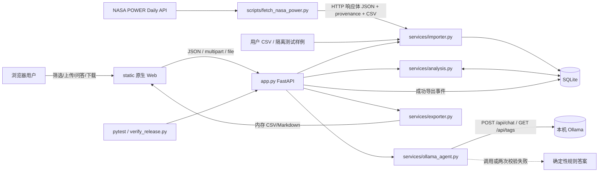
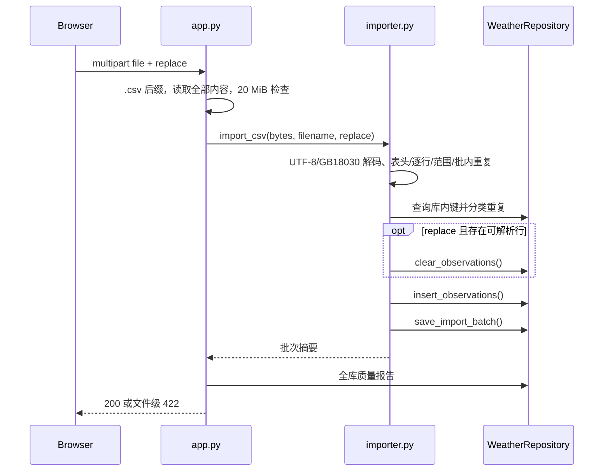

# 农田气象时序分析 Agent：当前工程架构

| 属性 | 当前值 |
|---|---|
| 版本 | 1.2.0 |
| 核对日期 | 2026-08-22 |
| 架构 | FastAPI 单体分层 + 原生 Web + SQLite |
| 本地入口 | `http://127.0.0.1:8003` |
| 核心依赖 | FastAPI、Pydantic v2、SQLite、HTTPX、原生 HTML/CSS/JavaScript；Ollama 为可选本地进程 |

本文描述仓库中**已经实现**的模块、数据表、处理边界和部署方式。未来设想集中列在第 13 节，不与当前交付混写。

## 1. 架构目标与当前边界

### 1.1 已实现目标

- NASA POWER 正式数据/用户 CSV → 来源留存与校验 → SQLite → 确定性分析/证据 → Ollama 上下文生成 → CSV/Markdown → 审计回读形成可执行闭环。
- 统计、风险、Agent 和导出共享同一份 `result` 数据结构，避免前后端分别计算。
- 页面不依赖 CDN，核心统计不依赖模型；Ollama 不可用时自动返回确定性规则答案。
- 数据库路径可注入，测试使用隔离临时 SQLite。
- 失败导入、失败分析和成功导出均留下可查询记录。

### 1.2 当前边界

- 单用户、无登录/权限系统。
- 同步执行：分析、Agent 筛选分析与 Ollama 上下文生成均在当前 HTTP 请求内完成。
- 本地模型读取按问题检索的结构化上下文并自主生成正文；统计值由后端计算，最终证据由后端目录映射和校验。
- 无环境变量时默认使用本机 Ollama `qwen2.5:3b`（60 秒超时）；`start_platform.cmd` 会先检查模型，调用或输出校验异常时才进入规则回退。
- 单进程 SQLite；没有任务队列、缓存、分布式锁和数据库迁移框架。
- API 导出在内存生成响应，不在服务器运行路径中自动保存文件。
- 风险是固定阈值田间巡查提示，不是作物诊断。

## 2. 系统上下文与数据闭环



实际闭环：

```text
启动建表/默认正式数据为空库安装
 → 原始 NASA 响应、查询 URL、哈希和 provenance 留存
 → CSV 文件级和逐行校验
 → observation + import_batch + dataset_source
 → 筛选有效质量标记
 → 日/月/季节/地块聚合
 → 趋势、IQR、风险事件、结论
 → analysis_run.result_json
 → 按问题检索 analysis_context + evidence_catalog，同时生成规则回退正文
 → Ollama 生成 answer + evidence_ids
 → JSON Schema、主题、月份、风险语义、指标数字与引用校验 → 服务端证据回填 → 失败才规则回退
 → agent_runtime 随响应和 agent_query.context 持久化
 → CSV/Markdown 响应 + audit_event
 → 历史与审计回读
```

## 3. 实际工程结构

```text
agri-weather-agent/
├─ app.py                         # FastAPI 工厂、请求模型、路由、静态挂载
├─ domain/
│  └─ models.py                  # Observation、季节/指标常量、日期解析
├─ repositories/
│  └─ database.py                # WeatherRepository、建表、SQL、JSON 映射
├─ services/
│  ├─ analysis.py                # 质量/聚合/风险、问题相关上下文与证据目录
│  ├─ importer.py                # CSV 解码、别名、校验、重复处理、批次摘要
│  ├─ exporter.py                # CSV 与 Markdown 字符串生成
│  ├─ ollama_agent.py            # 本地模型调用、输出约束、健康检查与规则回退
│  └─ sample_data.py             # 隔离测试使用的固定种子三地块样例
├─ static/
│  ├─ index.html
│  ├─ styles.css
│  └─ app.js                     # API 客户端、状态、Canvas 图表、交互
├─ tests/
│  ├─ conftest.py
│  ├─ test_api.py
│  ├─ test_domain_rules.py
│  ├─ test_ollama_agent.py       # 动态上下文生成/引用映射/数字护栏/runtime
│  ├─ test_nasa_power.py         # POWER 归一化、太阳辐射单位换算
│  └─ test_import_transaction.py # replace 导入事务回滚
├─ scripts/
│  ├─ ensure_local_model.ps1      # 检查 Ollama、模型存在性并按需拉取
│  ├─ fetch_nasa_power.py         # 官方 API 下载、原始留存、归一化、安装
│  ├─ verify_release.py           # 隔离数据库全闭环及真实导出证据
│  └─ reset_demo_data.py          # 重置默认库、播种并分析
├─ data/
│  ├─ agri_weather.db             # 已安装 NASA 正式数据的默认运行库
│  ├─ nasa_power_shenzhen_2024.csv
│  ├─ nasa_power_shenzhen_2024.provenance.json
│  ├─ raw/nasa_power_2024/*.json # 三个网格原始 API 响应
│  └─ sample_weather_2024.csv    # 隔离测试/导入边界样例
├─ exports/                       # 验证脚本保存的下载产物
├─ docs/evidence/                 # 验证证据
├─ Dockerfile
├─ requirements.txt
├─ start_platform.cmd
├─ stop_platform.cmd
└─ run_tests.cmd
```

当前不存在独立的 `config.py`、`domain/seasons.py`、`domain/risks.py`、`weather_repository.py` 或通用多供应商 Agent 框架；相关职责分别集中在 `app.py`、`domain/models.py`、`services/analysis.py`、`services/ollama_agent.py` 和 `repositories/database.py`。

## 4. 模块职责与依赖

| 模块 | 当前职责 | 直接依赖 |
|---|---|---|
| `app.py` | 应用工厂、默认正式数据安装、Agent runtime 装配、Pydantic 请求、HTTP 状态、来源路由、CORS、静态页面 | repository、全部 service |
| `domain/models.py` | `Observation`、`SEASONS`、指标名称/单位、日期与季节函数 | 标准库 |
| `repositories/database.py` | SQLite 连接、DDL、参数化查询、业务记录序列化 | domain |
| `services/importer.py` | 文件解码、表头/范围/重复校验、写观测与批次 | domain、具体 repository |
| `services/analysis.py` | 质量、区域日序列、聚合、趋势、IQR、风险、结论、问题相关上下文、排名/区间汇总、可信证据目录与规则回退正文 | domain、具体 repository |
| `services/ollama_agent.py` | 读取环境、探测模型、调用 `/api/chat`、JSON Schema、引用映射、主题/月度/风险语义/指标数字校验、一次重试、runtime/回退 | HTTPX |
| `scripts/fetch_nasa_power.py` | 调用 POWER Daily API、保存 HTTP 响应体字节、归一化字段和单位、生成 provenance、可选安装数据库并分析 | 标准库、repository、importer、analysis |
| `services/exporter.py` | 从已解析分析对象生成 CSV/Markdown | 标准库 |
| `static/app.js` | 浏览器状态、API 编排、渲染和下载 | HTTP API |

依赖方向总体为 UI → API → service → repository/domain，但 service 当前直接依赖具体 `WeatherRepository`，尚未抽象仓储协议。HTTP 路由不直接写 SQL；前端不重算核心农业气象统计。

## 5. 应用创建与生命周期

`create_app(db_path=None, seed=True, auto_analyze=True, agent_runtime=None)` 是测试与运行共同入口：

1. 数据库路径取显式 `db_path`，否则取环境变量 `AGRI_DB_PATH`，最后回落到 `data/agri_weather.db`。
2. `WeatherRepository.initialize()` 幂等执行 `CREATE TABLE/INDEX IF NOT EXISTS`。
3. `seed=true` 且观测表为空时：若目标是默认库且正式 CSV/provenance 均存在，则通过导入器安装 `data/nasa_power_shenzhen_2024.csv`，并把来源写入 `dataset_sources`；否则才生成固定种子测试样例。
4. 默认正式数据覆盖深圳光明、龙岗、大鹏三个 POWER 网格，2024-01-01 至 2024-12-31 各 366 条，共 1,098 条；注入的临时测试库仍使用同规模合成样例，确保测试不访问网络和默认运行库。
5. 构造 `AnalysisService`；若未注入 `agent_runtime`，调用 `OllamaAgent.from_env()` 读取当前进程环境并建立 runtime 配置。
6. `auto_analyze=true`、有观测且没有任何成功分析时，自动创建一次全量成功分析。
7. 创建 CORS、路由与 `/static`；`/` 返回 `index.html`。

模块级 `app = create_app()` 会在导入 `app.py` 时执行以上初始化，因此 Agent 环境变量应在 Uvicorn 导入模块前设置。测试通过临时路径建立独立数据库，并可注入 rules/mock runtime，不请求真实 Ollama。

默认运行库的 NASA 正式数据经 CSV 导入器写入，当前 1,098 条均有效且来源已登记。只有非默认空库的合成测试播种会直接插入 `Observation`；`verify_release.py` 另行使用带缺测的样例 CSV 验证拒绝/告警路径，两者不得被描述为默认正式数据。

## 6. SQLite 数据架构

### 6.1 连接策略

- 每个 repository 方法打开独立连接，`timeout=15` 秒。
- `row_factory=sqlite3.Row`。
- 每次连接启用 `PRAGMA foreign_keys=ON`、`PRAGMA journal_mode=WAL`。
- 上下文正常退出提交；异常关闭连接时 SQLite 回滚未提交事务。
- SQL 值均使用参数绑定；筛选 SQL 由固定白名单分支构造。

### 6.2 实际数据表

#### `observations`

| 字段 | 类型/约束 |
|---|---|
| `id` | INTEGER PK AUTOINCREMENT |
| `timestamp` | TEXT NOT NULL |
| `plot_id` | TEXT NOT NULL |
| `temperature_c` | REAL NULL |
| `precipitation_mm` | REAL NULL |
| `solar_radiation_wm2` | REAL NULL |
| `humidity_pct` | REAL NULL |
| `quality_flag` | TEXT NOT NULL DEFAULT `valid` |
| `created_at` | TEXT NOT NULL DEFAULT CURRENT_TIMESTAMP |
| `updated_at` | TEXT NOT NULL DEFAULT CURRENT_TIMESTAMP |

唯一约束：`(timestamp, plot_id)`；索引：`timestamp`、`(plot_id, timestamp)`。

#### `analysis_runs`

`id`、`created_at`、`status`、`filters_json`、`summary`、`result_json`。索引仅为 `created_at DESC`。完成状态为 `completed`，失败状态为 `failed`；没有 `pending/running`。完整派生结果保存在一列 JSON 中。

#### `import_batches`

保存文件名、SHA-256、替换模式、总/有效/插入/拒绝/警告/重复计数，以及 `reason_counts_json/errors_json/warnings_json`；按 `created_at DESC` 建索引。SHA-256 当前没有唯一约束。

#### `dataset_sources`

保存 `source_key`（唯一）、`provider`、`dataset_name`、`landing_page`、`query_urls_json`、完整 `provenance_json`、获取时间和 `active` 标志。每次 `save_dataset_source` 先停用旧来源，再插入或更新同一 `source_key`；`GET /api/data/source`、健康检查摘要、概览和 Agent 的 `data.source` 证据均读取当前活动行。

#### `agent_queries`

保存 `analysis_id`、问题、最终回答、`context_json`、`evidence_json` 与创建时间。`context_json.agent_runtime` 保留该次回答来自本地模型还是规则回退；`analysis_id` 是逻辑引用，没有数据库外键。

#### `audit_events`

保存 `event_type`、字符串 `reference_id`、`details_json` 与创建时间。目前只记录成功导出。

### 6.3 没有单独落表的对象

- 观测表没有 `import_id` 或 `source_id`，无法从单条观测反向定位导入批次/来源；当前来源是数据集级关联。
- 季节指标、异常、风险事件和结论均在 `analysis_runs.result_json`，没有 `seasonal_metrics/risk_events` 表。
- 没有 `export_records`；导出审计使用通用 `audit_events`。
- 表之间没有实际 FOREIGN KEY 约束，也没有 schema version/migration 表。

### 6.4 事务边界

- 单次 `insert_observations` 的循环写入在一个连接事务内。
- 导入批次保存是独立 repository 调用。
- `replace=true` 的清表和后续插入是两个已提交事务，不是原子整库替换。
- 分析先在内存完成，再以一个 `analysis_runs` 行保存；没有多张派生表的一致性问题。
- Agent 完成动态生成或规则回退后再单独保存问答及 runtime 上下文；导出先单独保存审计，再构造响应。
- 正式 CSV 的观测替换、来源登记和自动分析是三个独立提交；安装脚本通过数量、哈希和分析结果做事后闭环校验。

## 7. 核心处理流程

**正式数据获取前置流程。** `scripts/fetch_nasa_power.py` 对光明 `(22.7489, 113.9359)`、龙岗 `(22.7215, 114.2469)`、大鹏 `(22.5963, 114.4797)` 分别调用 POWER Daily API v2.9.7，参数为 `T2M/PRECTOTCORR/ALLSKY_SFC_SW_DWN/RH2M`、`community=AG`，响应声明 `time_standard=LST`。脚本直接保存三个 HTTP 响应体及各自 SHA-256，将 366 日×3 点归一化为 1,098 行 CSV；太阳短波辐射按 `MJ/m²/day × 1,000,000 ÷ 86,400` 换算为日均 `W/m²`。`--install` 再执行整库替换、`dataset_sources` 登记和一次全量分析，并检查记录数量守恒。交付中的 2026-08-22 既有文件由旧脚本解析后重排版，provenance 明确标为 `normalized_json_snapshot`；2026-08-23 已重新请求并确认 4,392 个参数日值零差异。

### 7.1 CSV 导入



文件级失败也保存批次。行级失败允许部分导入。`replace=false` 下精确重复保留原记录，冲突重复拒绝；`replace=true` 是清表后插入解析成功的批内唯一行。上传内容目前先完整读入内存，再检查 20 MiB。

### 7.2 分析

```text
Pydantic/季节/日期校验
 → SQLite 筛选观测
 → 无数据则保存 failed
 → 全部源记录生成质量报告
 → 只保留 valid/observed/corrected/imputed
 → 区域逐日、四季、季节年、地块季节、月份聚合
 → 趋势 + IQR + 风险事件
 → 7 条风险摘要 + 5 条结论
 → 单行保存 filters_json + result_json，status=completed
```

`suspect/rejected` 不进入统计、异常和风险，但进入质量摘要。请求模型校验失败由全局异常处理器保存 `failed`；分析业务 `ValueError` 也保存 `failed`。其他未捕获异常沿 FastAPI 传播，不自动保存失败任务。

### 7.3 Agent

```text
显式 analysis_id → 仅查询该记录 → 不存在 404 / 非 completed 409
未指定 ID 且有筛选 → 同步并保存新分析
未指定 ID 且无筛选 → 最新 completed；没有则 404
 → services/analysis.py 识别问题事实组和月份范围
 → 从 result 检索相关概览/季节/月度/排名/区间/趋势/风险/质量/来源
 → 构造紧凑 analysis_context、可信 evidence_catalog 和规则回退正文
 → services/ollama_agent.py 让 qwen2.5:3b 生成 answer + evidence_ids
 → 校验 JSON Schema、主题、月份、风险语义、引用与指标数字；失败时自动重试一次
 → 将 evidence_ids 映射成服务端证据；调用或校验仍失败才返回规则正文
 → 顶层 agent_runtime 复制到 context.agent_runtime
 → 保存 agent_queries 并返回 200
```

数据问题路由覆盖降水、温度、辐射、湿度、质量、风险、来源和概览，普通对话还识别问候、能力、感谢和告别。路由只决定检索哪些事实，模型根据问题动态组织正文。显式 ID 具有严格语义：不存在的 ID 不会再按请求筛选重新分析，也不会回退最新成功分析。

`OllamaAgent` 接收问题相关只读上下文、证据目录和仅用于故障回退的规则正文。调用本机 `/api/chat` 时，Ollama JSON Schema 要求且只允许 `answer`、`evidence_ids`；模型不能写回分析快照。服务端将模型引用限制为目录键，排名问题要求对应月份证据，主题问题要求对应指标/来源证据，并检查风险表述是否与 `risk.*` 状态和触发条件一致。指标数字只能来自服务端证据 value；年份、月份、日期仅作为时间标识处理。`_claim_number_tokens` 会先剔除明确的日历标识，用户问题中的普通数值不会进入允许数字集合。第一次输出失败会附校验原因重试，第二次仍不合格或调用失败时返回规则正文；最终 `evidence` 始终来自服务端对象。

`agent_runtime` 固定包含 `mode/provider/model/ready/fallback_used/fallback_reason/latency_ms`。`GET /api/health` 通过 Ollama `/api/tags` 检查配置模型是否存在，但模型不可用不会把主服务健康状态降级；数据库失败才返回 `503`，响应仍携带 runtime。可能的回退原因为 `provider_disabled`、`unsupported_provider`、`model_unavailable`、`unreachable`、`timeout`、`http_error`、`transport_error`、`invalid_json`、`invalid_response`、`missing_citations`、`incomplete_answer`、`unsupported_numbers`、`too_verbose`、`inconsistent_risk_claim`。最后两项分别表示重试后普通对话仍超过 100 字，以及风险陈述与所引 `risk.*` 证据的状态或触发条件矛盾。

### 7.4 导出与审计

```text
analysis_id 优先
 → 否则有筛选则 preview_analysis（不写分析历史）
 → 否则最新 completed
 → save_audit_event
 → exporter 生成内存字符串
 → PlainTextResponse 下载
```

CSV 优先使用 `seasonal_by_plot`；带 BOM。Markdown 使用同一分析结果。API 本身不写 `exports/`，验证脚本负责保存响应并计算哈希。

## 8. 统计、异常与风险算法

### 8.1 区域日序列与聚合

- 同一天多地块按指标算术平均形成区域日序列。
- 总降水为区域日均降水跨日累加，避免地块数量扩大总量。
- 雨日阈值为区域日降水 `>=0.1 mm`。
- 最长少雨为连续存在日期且区域日降水 `<1.0 mm`；缺测或日期断点中止。
- 温度平均/极值、辐射平均、湿度平均使用有效记录值。
- `seasonal` 固定返回四季；春 3–5、夏 6–8、秋 9–11、冬 12–2，12 月归下一 `season_year`。
- `seasonal_by_plot.expected_days` 是该组首末源记录日期的闭区间天数，不是固定完整季节天数；`valid_days` 为有效质量记录的不同日期数。

### 8.2 趋势

`_daily` 排序后的现有日序列以数组下标 `0..n-1` 作为 x，做一元线性回归，再乘 30 得 `slope_per_30_days`。这不是按真实日期差回归；日期缺口会被压缩。

- 少于 2 个有效点：斜率 `null`。
- 少于 30 个点：即使斜率可算，`direction` 标记为 `样本不足`。
- 方向容差：温度/降水 0.1、辐射 1.0、湿度 0.2（每 30 日单位）。

### 8.3 IQR 异常

按 `(plot_id, season_year, season, metric)` 分组；每指标至少 8 个非空样本。Q1/Q3 用位置 `(n-1)q` 线性插值：

```text
lower = Q1 - 1.5 × (Q3-Q1)
upper = Q3 + 1.5 × (Q3-Q1)
```

`IQR=0` 不标记。异常保留原记录；完整计数写入 `counts/group_counts`，按越界距离排序后，详情 `items` 最多返回 40 条。

### 8.4 风险规则

| 代码 | 当前阈值 | 严重度 |
|---|---|---|
| `HEAT_DAY` | `temperature_c >= 35°C`，连续命中日合成一个事件 | 中 |
| `HEAT_STREAK` | 连续 3 日 `>=35°C` | 高 |
| `COLD_DAY` | `temperature_c <= 0°C`，连续命中日合成一个事件 | 高 |
| `HEAVY_RAIN` | `precipitation_mm >=50 mm/day`，连续命中日合成一个事件 | 高 |
| `DRY_SPELL` | 连续 7 日 `<1 mm/day` | 中 |
| `LOW_LIGHT_STREAK` | 连续 3 日 `<100 W/m²` | 中 |
| `TEMP_SWING` | 相邻日期温差绝对值 `>=10°C` | 中 |

事件按地块扫描，日期断点和阈值不命中会截断连续事件。`risks` 固定返回 7 条规则摘要，摘要 `metric/event_count` 是事件数；`risk_events` 返回事件明细。

## 9. API 与错误边界

完整契约见 `API.md`。当前关键事实：

- 成功分析状态为 `completed`，不是 `succeeded`。
- latest 无筛选参数，只返回最新完成任务。
- history 无 status 筛选，并返回完整 `result_json`。
- 业务错误使用 FastAPI `{"detail": ...}`，没有统一错误码或请求 ID。
- `/api/analysis/run` 的 422 会创建失败分析；其他路由的一般 422 不创建业务记录。
- CORS 为 `allow_origins=["*"]`、全部方法/头，`allow_credentials=false`。

## 10. 前端架构

`static/app.js` 使用 IIFE 和单一内存状态：

```json
{
  "overview": null,
  "observations": [],
  "observationTotal": 0,
  "analysis": null,
  "history": [],
  "filters": {
    "plot_id": "",
    "year": "",
    "season": "",
    "start_date": "",
    "end_date": ""
  },
  "granularity": "month",
  "seasonMetric": "temperature",
  "tableVisible": 10,
  "selectedFile": null,
  "busyCount": 0,
  "health": false
}
```

- API 根固定为相对路径 `/api`。
- 请求由 `Api.request` 统一超时、解析 `detail`、转换可读错误；分析/Agent 超时 60 秒，导入 90 秒。
- 观测加载上限 5000；浏览器内做图表粒度显示。
- 温度、降水、光照和季节对比使用高 DPI Canvas，迷你趋势使用内联 SVG。
- 导出使用 `fetch → Blob → 临时下载链接`，文件名优先解析 `Content-Disposition`。
- 侧栏/抽屉、忙碌态、空态、图表工具提示和响应式 CSS 已落地。
- 状态不写入 localStorage/sessionStorage；页面刷新后重新从 API 获取。
- 前端当前不暴露 `season_year` 筛选，也不展示导入、问答、审计历史接口的全部能力。

## 11. 配置、启动与部署

### 11.1 当前配置

| 配置 | 代码默认值 | `.env.example` | `start_platform.cmd` / 当前行为 |
|---|---|---|---|
| `AGRI_DB_PATH` | `data/agri_weather.db` | `data\agri_weather.db` | 未显式覆盖时使用代码默认路径 |
| `AGRI_AGENT_PROVIDER` | `ollama` | `ollama` | `ollama`；直接启动与标准脚本均优先调用本地模型 |
| `AGRI_OLLAMA_BASE_URL` | `http://127.0.0.1:11434` | 同默认值 | 同默认值 |
| `AGRI_OLLAMA_MODEL` | `qwen2.5:3b` | 同默认值 | 同默认值 |
| `AGRI_OLLAMA_TIMEOUT_SECONDS` | `60` 秒 | `60` 秒 | `60` 秒，为首次加载预留时间 |
| `AGRI_AGENT_FALLBACK` | `rules` | `rules` | `rules` |
| 主机/端口 | `app.py __main__` 为 `127.0.0.1:8003` | — | 标准脚本同左；Docker 为 `0.0.0.0:8003` |
| 上传限制 | 代码常量 20 MiB | — | 上传内容读入内存后检查 |
| 风险阈值版本 | 代码常量 `agri-weather-default-v1` | — | 不是环境变量 |

`.env.example` 只是赋值样例，应用不会自动加载 `.env`。`APP_HOST/APP_PORT/DATABASE_PATH/EXPORT_DIR/LOG_LEVEL` 当前均未读取。代码默认 provider 为 `ollama`，所以直接 `create_app()` 与标准脚本都会优先调用 `qwen2.5:3b`；Ollama 不可达、超时、返回异常或输出未通过服务端校验时才进入 `rule_fallback`。隔离测试显式注入 rules/mock runtime。

### 11.2 启停

- `start_platform.cmd`：写入 Ollama 环境变量，检查 FastAPI/Uvicorn，调用 `scripts/ensure_local_model.ps1` 探测/启动 Ollama、按需拉取模型并冒烟；模型步骤失败只记录提示，随后运行 `pytest -q`，通过后启动 8003 并打开浏览器。
- `stop_platform.cmd`：结束监听 8003 的进程。
- `run_tests.cmd`：运行 pytest 并透传退出码。
- `Dockerfile`：Python 3.13 slim，安装 requirements，Uvicorn 监听所有容器网卡。

Docker 容器内的 `127.0.0.1` 指向容器自身。若 Ollama 运行在 Windows 主机，应显式传入：

```powershell
docker run --rm -p 8003:8003 `
  -e AGRI_AGENT_PROVIDER=ollama `
  -e AGRI_OLLAMA_BASE_URL=http://host.docker.internal:11434 `
  -e AGRI_OLLAMA_MODEL=qwen2.5:3b `
  -e AGRI_AGENT_FALLBACK=rules `
  agri-weather-agent:1.2.0
```

主机 Ollama 需监听容器可访问的接口；未配置成功时应用继续以 `rule_fallback` 提供确定性问答。

## 12. 测试与可验证交付

### 12.1 自动测试

当前自动化基线为 **47 passed**。`tests/test_api.py` 覆盖 v1.2.0 健康/播种、正式来源持久化与接口、用户/混合来源切换、来源登记失败时撤销旧声明、筛选分页、分析结构、跨年冬季、Agent 证据/runtime、严格分析 ID、导入、失败隔离和下载。`tests/test_domain_rules.py` 覆盖季节年、连续干日和风险边界；`tests/test_import_transaction.py` 覆盖替换导入回滚；`tests/test_nasa_power.py` 覆盖 POWER 响应归一化、`MJ/m²/day → W/m²` 与 HTTP 响应体字节保留；`tests/test_ollama_agent.py` 使用 `httpx.MockTransport` 覆盖动态上下文生成、月度证据映射、JSON Schema、重试/护栏、异常回退和 runtime 持久化，不依赖真实模型。

测试应用使用 `tmp_path/test.db`，默认播种合成夹具并自动分析；`conftest.py` 注入 provider=`rules` 的 runtime，不修改默认 NASA 运行库，也不会访问本机 11434 或 NASA 网络接口。

### 12.2 发布闭环

`scripts/verify_release.py` 使用 `.runtime/release_verify.db` 且关闭自动播种/分析，实际执行：

```text
空库健康检查
 → 上传 data/sample_weather_2024.csv
 → 运行 2024 分析
 → Agent 证据问答并返回 agent_runtime
 → 下载并解析 CSV
 → 下载并检查 Markdown
 → 审计回读
 → 写 exports/* 与 docs/evidence/api_verification.json
```

此脚本对输出行、字段、内容和 SHA-256 生成可核验证据。

## 13. 明确未落地项与工程约束

| 项目 | 当前状态/影响 |
|---|---|
| 异步任务队列、`pending/running` | 未实现；长分析占用当前请求 |
| 独立配置模块和阈值文件 | 未实现；阈值/端口/大小限制在代码或脚本中 |
| Repository 接口/依赖注入容器 | 未实现；service 直接依赖具体 SQLite repository |
| 数据库迁移和 schema version | 未实现；只有幂等建表，结构升级需人工方案 |
| 观测到导入批次的 FK | 未实现；单条记录不可追溯具体批次 |
| 派生结果规范化表 | 未实现；完整 JSON 随历史增长，历史接口响应可能变大 |
| 全流程事务 | 未实现；特别是 `replace=true` 清表与插入分属事务 |
| 文件哈希幂等拦截 | 未实现；SHA-256 仅审计 |
| 流式上传和读前限流 | 未实现；先读完整文件再检查 20 MiB |
| MIME 内容嗅探、CSV 单元格长度/列数限制 | 未实现；依赖后缀和 CSV 解析 |
| 统一错误码、request_id、结构化日志 | 未实现；使用 `detail` 与默认服务日志 |
| 登录、授权、租户隔离 | 未实现；CORS 允许任意来源 |
| 远程云 LLM、多模型路由和流式生成 | 未实现；当前只接本机 Ollama，统计与证据仍由确定性后端掌握 |
| API 自动落盘导出/导出记录表 | 未实现；只返回响应并记通用审计 |
| 浏览器 E2E 纳入 pytest/CI | 未实现；仓库已有现场采集脚本和 JSON/截图证据，但未作为 pytest 门禁 |

这些项目不是当前契约的一部分；引入时需要同步更新代码、迁移、测试、OpenAPI 与 `docs/API.md`。

## 14. 当前架构决策

| 决策 | 当前选择 | 收益 | 代价 |
|---|---|---|---|
| ADR-001 | FastAPI + 原生 Web | 启动简单、离线、接口直观 | 前端组件和类型复用有限 |
| ADR-002 | SQLite WAL | 零外部服务、便于演示与隔离测试 | 多进程写入和大型历史受限 |
| ADR-003 | 分析结果 JSON 快照 | Agent/导出口径一致、历史可复核 | 难做细粒度 SQL 与增量迁移 |
| ADR-004 | 确定性事实/证据层 + 本地 Ollama 上下文生成 + 自动规则回退 | 回答动态自然，同时数值可解释、模型故障不阻断、来源可审计 | 检索仍依赖问题词和月份表达；本机模型增加安装与响应延迟 |
| ADR-005 | 同步分析 | 流程清楚、无需队列 | 大数据量下请求耗时增长 |
| ADR-006 | Canvas/SVG 无 CDN | 交付稳定、高 DPI 可控 | 图表维护成本高于成熟组件库 |
| ADR-007 | 默认 NASA POWER 正式数据 + 隔离测试合成夹具 | 演示数据可追溯，测试仍快速可复现 | 网格数据不等同于站点实测，两个数据集的业务数值不同 |
| ADR-008 | HTTP 响应体、查询 URL、SHA-256 与 `dataset_sources` 双层来源追溯 | 可复核下载、归一化和当前活动来源；用户导入会切换为用户/混合来源 | 来源登记与观测替换目前不是单事务 |


